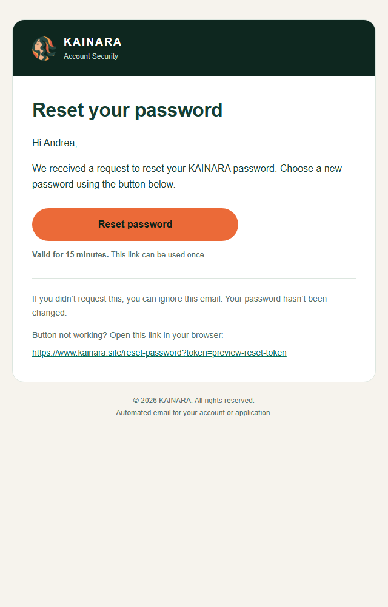
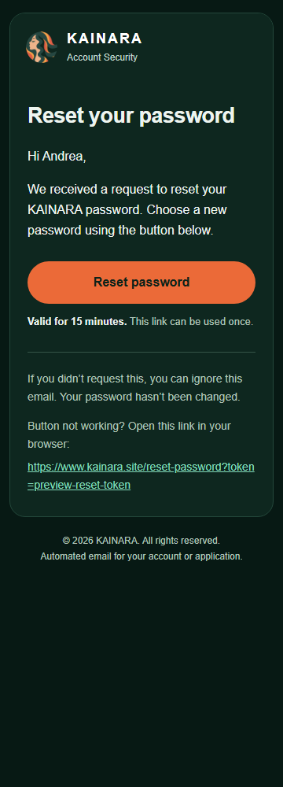
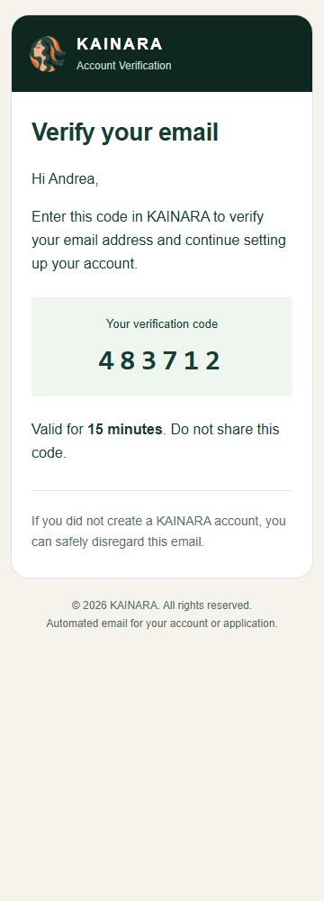

# Transactional email refinement

October 13, 2026. Local work in `C:\Users\chima\Desktop\Nutrimind`.

The owner requested an Impeccable refinement of the password-reset email. The shared design now uses a compact pine masthead, one message surface, readable typography and a clear action. Cream/light styling has inline fallbacks; supporting CSS supplies a dark variant where the email client supports it. Duplicate reset expiry/security panels, decorative gradients, heavy shadows and email emoji have been removed. The code or action remains the main focus.

All six sender functions share the renderer: account/application verification, password reset, RND invitation, scheduled call, application received and review feedback. OTP/reset expiry remains 15 minutes, invitations remain 72 hours, and meeting time remains Manila time. Subject lines, delivery providers, addresses, scheduling and authentication behavior remain in place. Token URLs preserve their decoded value, trailing origin slashes are normalized and URL attributes are escaped. Local logo previews now reference the current public KAINARA asset instead of an older GitHub repository.

## Verification

- Backend TypeScript and changed-file lint passed.
- Eight focused email/authentication tests passed, including provider failures, SMTP/HTTPS behavior, captured scheduling, OTP proof, token preservation and HTML/URL escaping.
- Seven offline preview variants rendered at 360px and 640px in both light and dark browser schemes, with no horizontal overflow. Reset, verification, call and receipt screenshots were visually inspected.
- `npx tsx scripts/preview-email-templates.ts`, run from `backend`, generates synthetic HTML previews in `backend/.local/email-previews`. It intercepts provider requests and never connects to a database or delivers mail.
- These are browser previews of generated HTML, not live Gmail/Outlook inbox verification. Embedded CSS and automatic dark-mode handling vary between clients; table layout and inline light styles are retained as the fallback.

Local only. No real emails sent, shared database changes, migration or deployment. Already received emails cannot change; the new templates apply to future messages from this backend version.

