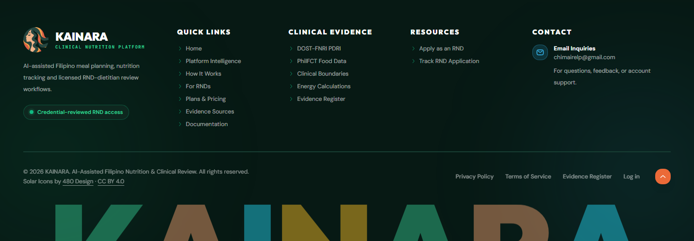
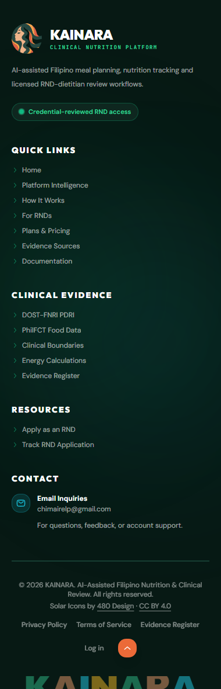

# Landing source navigation and footer — October 13, 2026

## Changes

- Pointer activation freezes the shared source slider at its current position and retains both link copies until native activation completes. Keyboard focus retains the static scrollable list with only one set of citations; reduced-motion preferences remain respected. Link destinations and new-tab behavior are unchanged.
- The shared public footer retains its five-column layout, brand, Quick Links and Clinical Evidence. Workspaces becomes Resources with only Apply as an RND and Track RND Application. Contact retains the existing email and adds the owner-approved support copy; office/location/hours claims are removed. The bottom entry is now Log in; legal links, icon attribution and back-to-top remain.
- The shared footer covers the landing page, Pricing, Documentation and RND application page. No shared header changes were included; the preexisting header edits remain separately owned.

## Verification

- 12 focused frontend tests passed across the shared slider, footer and landing navigation. Tests cover pointer activation of both copies without node removal, subsequent keyboard focus, reduced motion, footer destinations and back-to-top.
- Six unique Chromium journeys at actual localhost:3000 passed: first-click navigation on original/repeated cards at 390/1440 px in light/dark themes, keyboard Enter activation, and reduced motion. External navigation is fulfilled with a local HTML fixture, and browser APIs are intercepted; this checks link activation and exact requested destination, not availability/content of source websites.
- Four footer captures were inspected. The screenshot-only style hides the fixed header and development badge so they do not overlay the tall mobile element capture. The rendered product header is unchanged.
- Scoped ESLint, frontend production build, and diff whitespace check pass.
- Work is local to the shared Desktop checkout on the existing branch. No deployment, credentials, database or provider configuration changed.

## Preview

