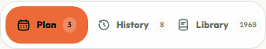

# Meals tab counts — October 13, 2026

## Result

History and Library show their totals on entry to `/meals`, before opening either tab. The brief loading ellipsis is replaced as soon as each independent count arrives. Empty collections display `0`. A failed count shows `?` and a Retry counts action.

## Data and boundaries

- `GET /api/user/meals/history/count` uses only the authenticated member ID and the same default statuses as History.
- `GET /api/user/meals/verified-recipes/summary` shares the existing catalogue service. Unrestricted counts use SQL counts after admission/exclusion filtering, without loading display cards or current/upcoming annotations. Food exclusions still require ingredient screening.
- Restricted counts retain the existing full compatibility evaluation in bounded chunks. Only total/admitted identities are returned for combining with approved plan groups; no image resolution, provider call or raw clinical profile is returned. This scan has the same clearance circuit breakers as existing compatible-library reads.
- Account, filter and safety revision scopes prevent cross-account or stale filter totals. Count reads do not poll hidden tabs. Full History and Library payloads stay lazy.
- Normal frontend/backend remain on 3000/5000 in the shared Desktop checkout. Tests intercepted all browser APIs and mocked backend persistence, without writes to the shared defense database. This is a local implementation; live release verification is pending deployment.

## Verification

- Frontend: 46 tests across `useMealLibraryCount`, `useMealHistory`, `useMealsWorkspace`, `MealsLibraryLoading`, `MealLibraryPanel`, and `MealLibraryPagination` passed.
- Backend: 7 tests in `ui-audit-catalog-and-report` passed, including authenticated history count, summary filters, no card/annotation reads, and restricted identity collection beyond the requested page with flagged recipes excluded.
- Browser: 4 Chromium journeys on localhost:3000 passed at 390/1440 px in light/dark themes. Counts appear while Plan remains selected, failed counts recover with Retry counts, no hidden full-list requests and no horizontal overflow.
- Backend and frontend production builds passed; scoped lint and diff whitespace checks passed.

## Synthetic preview

The numbers below are fixtures, not a report of live database totals.

