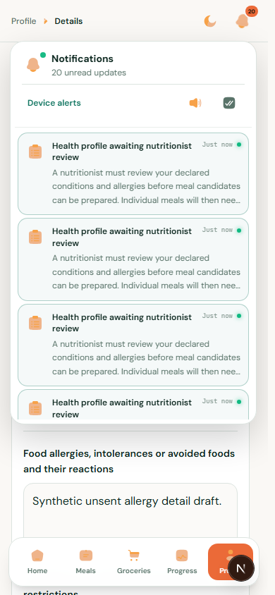
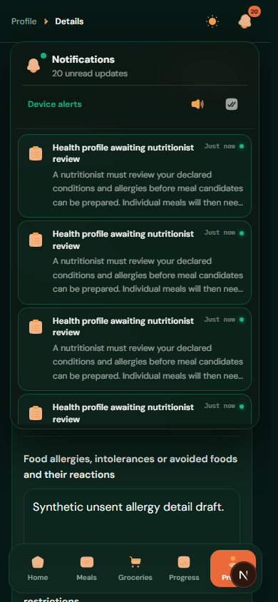
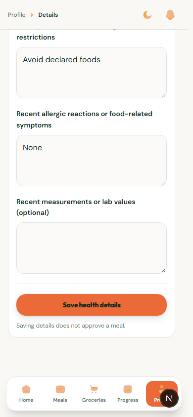

# Mobile health forms and notifications

October 13, 2026 — local only, in `C:\Users\chima\Desktop\Nutrimind`.

The owner reported a phone notification header in which the unread badge collided with Device alerts and other controls. The shared notification popover now stacks its controls below the heading on narrow screens, removes the redundant unread badge, uses 44px control targets and fits within the viewport. Its list scrolls within available height above mobile navigation. A conflicting `block` class had disabled the intended line clamp; previews now correctly use three lines on phones and two on desktop. The full message remains in the DOM and notification routing is preserved.

The member health inbox has tighter phone spacing and a clear stacked heading/status. Embedded allergy forms avoid repeated introductory instructions; phone textareas use 16px text while desktop retains 14px. Saved/unsent answers and submission rules are unchanged.

## Evidence

- 41 notification, clinical workspace and clarification-form unit tests passed.
- Six actual Chromium journeys at localhost:3000 passed: 320px, 390px and 1440px, each in both themes.
- Browser assertions cover heading/control separation, viewport boundaries, 44px targets, preview height, long-list scrolling, mark-all-read, Escape, mobile form draft retention, field font size and Save above bottom navigation.
- Frontend TypeScript and changed-file lint passed. API requests were intercepted with synthetic accounts and twenty synthetic notifications to exercise scrolling. No shared database/account changes, schema change or deployment.
- These are responsive Chromium checks, not a claim of testing every mobile browser or the native Messenger browser.

Screenshots:

